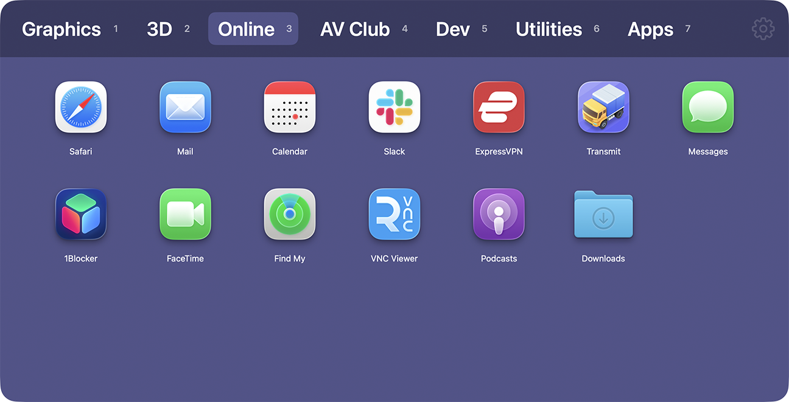

# Pad Launcher

A native macOS launcher in the spirit of the classic **DragThing.** A floating, tabbed pad of your apps, files, folders, and links that stays out of the way until you summon it with a **four‑finger trackpad pinch**.

<p align="center">
  
</p>

> *RIP Launchpad, 2011–2025.*

## Overview

Pad Launcher is a background (menu‑bar) app built with AppKit + SwiftUI. Pinch four fingers together on the trackpad and a launcher panel appears, centered where your cursor is. Click something to open it and the panel dismisses; click away and it disappears. Everything you launch is organized into color‑coded tabs you arrange however you like.

It’s a personal, “unsanctioned” app: it uses a private multitouch framework to capture the pinch and is intentionally **not** sandboxed, so it isn’t an App Store app — it’s built for Developer ID / local use.

## Features

- **Four‑finger pinch to summon.** A global pinch reveals the launcher; selecting an item or clicking outside dismisses it. Pad Launcher can also free up the gesture from macOS Spotlight for you (a one‑time, opt‑in step).
- **Tabbed organization.** Up to 10 color‑coded tabs. Switch with a click or with bare number keys (`1`–`9`, `0` for the 10th).
- **Add anything.** Drag apps, files, folders, or URLs onto a tab — or use the Finder contextual menu **“Add to Pad Launcher ▸ <tab>”** (with multi‑item selection).
- **Direct manipulation.** Drag icons to reorder, drag them onto a tab’s name to move them to another tab, or hold **⌥ Option** while dropping on a tab to duplicate.
- **Multi‑select.** Rubber‑band drag to select a group; **⌘‑click** to toggle individual icons; **⇧‑click** to extend a range. Move, delete, or duplicate the whole selection at once.
- **Drag‑off to delete.** Drag an icon or tab off the window — a trash badge marks the drop zone.
- **Tab styling.** Recolor all tabs from the current tab’s color using color‑wheel harmonies — Complementary, Split Complementary, Compound, Shades, Triad, or a Rainbow sweep.
- **Live entries.** Items track the file they point to: renamed files update their label, and items whose target no longer exists are hidden automatically.
- **Fits your screen.** Resize manually from the edges or use the “Size Window to Fit” command to size to the most-populated tab.

## Requirements

- macOS 14 (Sonoma) or later.
- Xcode 16+ to build.

## Building

1. Clone the repo and open `TabLauncher.xcodeproj` in Xcode.
2. Select the **Pad Launcher** scheme, then set your own **Development Team** under *Signing & Capabilities* (the committed project intentionally ships with no team ID). The app and its Finder extension share an App Group, so both targets need the same team.
3. Build and run.

To build from the command line, pass your team ID:

```bash
xcodebuild -project TabLauncher.xcodeproj -scheme "Pad Launcher" \
  -configuration Release -derivedDataPath ./DerivedData \
  DEVELOPMENT_TEAM=YOURTEAMID build
```

The **Add to Pad Launcher** Finder extension is embedded in the app; enable it under **System Settings → General → Login Items & Extensions → Finder extensions** after first launch.

## Notes

- The pinch trigger relies on a private multitouch framework, and the app is non‑sandboxed (it launches arbitrary items, reads a trackpad preference, and hosts a Finder extension). That’s fine for signing with Developer ID and running it yourself; it is not eligible for the Mac App Store.
- The first time the Finder extension talks to the running app, macOS may ask to “allow access to data from other apps.” Allow it once.

## License

[MIT](LICENSE) © 2026 Rob Marquardt
